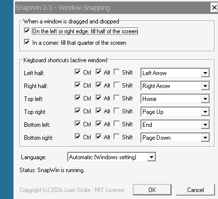

# SnapWin

Window snapping for **Windows 3.1 / 3.11**: drag a window to a screen edge
or corner, or press a shortcut, and it fills half or a quarter of the screen.



- **Halves**: drop a window on the left or right edge of the screen.
- **Quarters**: drop it in a corner.
- **Shortcuts** for the active window (defaults; configurable):

  | Shortcut               | Position              |
  |------------------------|-----------------------|
  | Ctrl+Alt+Left Arrow    | Left half             |
  | Ctrl+Alt+Right Arrow   | Right half            |
  | Ctrl+Alt+Home          | Top-left quarter      |
  | Ctrl+Alt+Page Up       | Top-right quarter     |
  | Ctrl+Alt+End           | Bottom-left quarter   |
  | Ctrl+Alt+Page Down     | Bottom-right quarter  |

- **Configured from Control Panel**, with changes applied immediately.
- **English and Spanish**: follows the Windows language setting, English
  by default; new languages can be added without touching the C code.
- **Invisible once installed**: starts with Windows, with no window, no
  icon and no Task List entry.
- **Tiny**: about 26 KB in total, written in C against the Win16 API.

Requires Windows 3.1 or later (Windows 3.0 has no `SetWindowsHookEx`).
Earlier releases were tested on a Pentium running Windows 3.1; every release
is tested under Wine (see [Testing](#testing)).

## Installing

Copy the files in `dist/` (or the release archive) to a floppy or a
directory, then in Program Manager choose **File > Run > SETUP.EXE**.
Run `SETUP.EXE` again to upgrade or uninstall. End-user documentation is in
[`doc/readme.txt`](doc/readme.txt) (English) and
[`doc/leeme.txt`](doc/leeme.txt) (Spanish), shipped as `README.TXT` and
`LEEME.TXT`.

## Building

You need [Open Watcom](https://github.com/open-watcom/open-watcom-v2)
1.9 or 2.0. It runs on DOS, Windows, OS/2 and Linux, and can build Win16
programs from any of them.

```sh
# Linux / macOS (adjust the path; use binl instead of binl64 on 32-bit hosts)
export WATCOM=/opt/watcom
export PATH=$WATCOM/binl64:$PATH
export INCLUDE=$WATCOM/h:$WATCOM/h/win
wmake
```

```bat
rem Windows (or DOS with binw instead of binnt)
set WATCOM=C:\WATCOM
set PATH=%WATCOM%\BINNT;%PATH%
set INCLUDE=%WATCOM%\H;%WATCOM%\H\WIN
wmake
```

Targets:

| Command        | Result                                              |
|----------------|-----------------------------------------------------|
| `wmake`        | `dist/`: the four binaries, `readme.txt`, `leeme.txt`, `license.txt` |
| `wmake tests`  | also the test programs, in `build/`                 |
| `wmake clean`  | removes the generated files                         |

The build should finish with no warnings: warnings are treated as errors
(`-wx -we`).

## How it works

```
                 every application (system-wide hooks)
   +------------------------------------------------------------+
   |  SNAPHOOK.DLL                                              |
   |    WH_KEYBOARD     shortcut pressed?        --+            |
   |    WH_CALLWNDPROC  window dropped on an       |            |
   |                    edge or corner?          --+            |
   +----------------------------------------------|-------------+
                                                  | PostMessage(WM_SNAP_DO,
                                                  |   position, hwnd)
                                                  v
   SNAPWIN.EXE  hidden window --> SetWindowPos(hwnd, half/quarter)
        ^
        | WM_SNAP_RELOAD                    SNAPWIN.INI
   SNAPCFG.CPL  Control Panel applet  <-->  (read by the DLL and the applet)
```

| File (in `src/`)          | Builds         | Role |
|---------------------------|----------------|------|
| `snaphook.c`              | `SNAPHOOK.DLL` | System-wide hooks. Win16 requires them to live in a DLL; the DLL's single data segment is shared by every task, so its globals are the shared state. |
| `snapwin.c`, `snapwin.rc` | `SNAPWIN.EXE`  | Resident program started from `load=` in `WIN.INI`. Owns a never-shown window, installs the hooks, and moves windows. `/QUIT` stops it. |
| `snapcpl.c`, `snapcpl.rc` | `SNAPCFG.CPL`  | Control Panel applet (a DLL exporting `CPlApplet`). Writes `SNAPWIN.INI` and tells `SNAPWIN.EXE` to reload it. |
| `setup.c`, `setup.rc`     | `SETUP.EXE`    | Installer/uninstaller: copies the files to `WINDOWS\SYSTEM`, edits `load=` without touching other entries, and handles upgrades. |
| `cfg.c`                   | (linked into the two DLLs) | Reads and writes `SNAPWIN.INI`. |
| `lang.c`, `lang.h`        | (linked into the EXEs and the applet) | Chooses the language and loads strings in it. `lang.h` lists every string ID. |
| `lang/en.rc`, `lang/es.rc`| (included by every `.rc`) | All user-visible text, one file per language: strings and the applet dialog. |
| `snapwin.h`               |                | Shared constants, messages, config structure. |
| `version.h`               |                | Version, author, license and URL. **The version number lives here only.** |
| `version.rc`              | (included by every `.rc`) | `VERSIONINFO` resource, so each binary carries its version, author and license. |
| `snaphook.rc`             |                | Version information for `SNAPHOOK.DLL`. |
| `resource.h`              |                | Icon and control IDs for the applet dialog. |

### Detecting the end of a drag

Windows 3.1 has no "move finished" notification for other applications'
windows. The `WH_CALLWNDPROC` hook watches each window's messages:

1. `WM_SYSCOMMAND` / `SC_MOVE` marks the window being moved.
2. With the default *outline* drag, Windows 3.1 sends a single
   `WM_WINDOWPOSCHANGED` when the window is dropped. The hook checks that
   the mouse button is up, then looks at the cursor position.
3. Environments with *full-window* drag send `WM_ENTERSIZEMOVE` /
   `WM_EXITSIZEMOVE`. If `WM_ENTERSIZEMOVE` is seen, the intermediate
   `WM_WINDOWPOSCHANGED` messages are ignored and `WM_EXITSIZEMOVE` ends
   the drag.

The corner zone is `1/SNAP_CORNER_DIV` of the screen (minimum
`SNAP_CORNER_MIN` pixels); both are in `snapwin.h`.

### Settings: `SNAPWIN.INI`

Stored in the Windows directory:

```ini
[SnapWin]
DragHalves=1          ; drop on left/right edge -> half
DragCorners=1         ; drop in a corner -> quarter
LeftKey=37            ; virtual-key code (VK_LEFT), 0 = no shortcut
LeftMods=6            ; 1 = Shift, 2 = Ctrl, 4 = Alt  (6 = Ctrl+Alt)
RightKey=39
RightMods=6
TopLeftKey=36         ; VK_HOME
TopLeftMods=6
TopRightKey=33        ; VK_PRIOR (Page Up)
TopRightMods=6
BottomLeftKey=35      ; VK_END
BottomLeftMods=6
BottomRightKey=34     ; VK_NEXT (Page Down)
BottomRightMods=6
Language=auto         ; auto (follow Windows), en, es
```

Releases up to 2.1 were in Spanish and used Spanish key names (`IzqTecla`,
`SupIzqMods`, `Arrastrar`...). `cfg.c` falls back to them when an English
key is missing, and deletes them the next time the settings are saved.

## Languages

SnapWin's user interface is available in **English** (default) and
**Spanish**. The language is chosen when each program starts:

1. `Language=` in `SNAPWIN.INI`, if set to a supported code (`en`, `es`).
   The applet's *Language* list writes this value.
2. Otherwise the Windows setting from Control Panel > International
   (`[intl] sLanguage` in `WIN.INI`: `enu`, `esp`, `esn`...): its first
   two letters are matched against the supported codes.
3. Otherwise English.

Win16 resources have no `LANGUAGE` attribute (it arrived with Win32), so
each language has its own block of resource IDs: a string's ID is its
base ID (in `lang.h`) plus `language * 1000`, and a dialog's ID is its base
ID plus the language number. `SnapLoadString()` loads a string in the
current language and falls back to English if it is missing.

The end-user readme exists in both languages (`doc/readme.txt`,
`doc/leeme.txt`). `SETUP.EXE` messages, the applet, and Control Panel's
name and description for it are translated. Message box buttons
(Yes/No/OK) are drawn by Windows itself, in the language of Windows.

### Adding a translation

1. **Pick a code**: the first two letters Windows 3.1 uses for that
   language in `[intl] sLanguage` (e.g. `fr` for `fra`, `de` for `deu`,
   `it` for `ita`).
2. **`src/lang.h`**: add `#define LANG_FR 2` (the next number), increase
   `LANG_COUNT`, and append `"fr"` to `LANG_CODES`, in the same order.
3. **`src/lang/fr.rc`**: copy `en.rc`, set `L_STR` and `L_DLG` to use
   `LANG_FR`, and translate every quoted text. Keep `%s` marks (in order)
   and `\n` line breaks; widen dialog controls if the text needs it. Save
   it in **Windows-1252** (the ANSI code page of Windows 3.1).
   `IDS_LANG_NAME` is the language's own name ("Français").
4. **Include it** in `snapcpl.rc`, `setup.rc` and `snapwin.rc` (after
   `es.rc`), and add it to `LANGRC` in the `makefile`.
5. **`doc/`**: optionally add a translated readme and copy it to `dist/`
   in the `makefile`.
6. **Check**: `wmake tests`, then run `langtest.exe` next to the binaries.
   It reports missing translations and truncated strings.

Two limits to keep in mind: a Win16 string resource holds at most
**255 characters** (longer ones are silently truncated by the resource
compiler, so split them as `IDS_SETUP_DONE` / `IDS_SETUP_DONE2` are), and
`wsprintf` output is limited to 1024 characters.

## Win16 pitfalls

These caused real bugs or near misses in this project:

- **Module names must be unique.** Win16 identifies loaded modules by name.
  Before loading a file, Windows also checks whether a module with the same
  base file name is already loaded. Version 1.0 shipped the applet as
  `SNAPWIN.CPL`. With `SNAPWIN.EXE` running, Control Panel got the EXE back
  from `LoadLibrary`, found no `CPlApplet` and **silently** skipped the icon.
  The applet is now `SNAPCFG.CPL`, linked with `modname=SNAPCFG`.
  `tests/modtest.c` guards against regressions.
- **Read the active window inside the hook.** `GetActiveWindow()` called
  from `SNAPWIN.EXE` returns that task's own state, not the user's window.
  The keyboard hook reads it in the context of the task receiving the key
  and passes it along in `lParam`.
- **Cooperative multitasking.** After `SETUP.EXE` sends `WM_CLOSE`, the old
  instance only exits once it gets to run. Setup yields until
  `SNAPHOOK.DLL` is unloaded before overwriting or deleting it.
- **DLL compile options.** DLL code must be built with `-zu` (SS != DS):
  the stack belongs to whichever task called into the DLL.
- **255-character strings.** `STRINGTABLE` entries are length-prefixed
  with a single byte. The resource compiler truncates longer strings
  without a warning; the Spanish "installed" message was cut in half until
  it was split in two. `tests/langtest.c` now catches this.
- **Swallowed shortcuts.** The keyboard hook returns 1 for a matching key,
  so the application never sees it. That is why the applet refuses
  shortcuts without Ctrl or Alt: a bare key would stop working everywhere.

## Testing

`wmake tests` builds four helpers into `build/`. Copy them next to the
binaries (or install first) and run them:

| Program        | What it checks |
|----------------|----------------|
| `hooktest.exe` | Opens a resizable test window, starts SnapWin and installs the hooks from its own task. Use it to try the shortcuts and drags. |
| `cpltest.exe`  | Loads `SYSTEM\SNAPCFG.CPL` with SnapWin running and drives `CPlApplet` like Control Panel, opening the dialog. |
| `modtest.exe`  | Regression test for the module-name clash. Prints `PASS`/`FAIL` with `OutputDebugString`. |
| `langtest.exe` | Checks every string in every language in the three binaries: reports missing translations and truncated strings, then `PASS`/`FAIL`. |

**On real hardware** (best), just install with `SETUP.EXE` and use any
application.

**Under Wine** (convenient for quick iteration):

- Wine runs 16-bit programs through `winevdm`.
- Wine does **not** implement system-wide Win16 hooks: they only fire in
  the task that installed them. That is why `hooktest.exe` installs the
  hooks in its own task.
- Each program launched separately with `wine` runs in its own process, so
  `FindWindow` may not see windows from another one. Launch related
  programs from a single 16-bit session (e.g. via `WinExec`) to mimic
  Windows 3.1.
- Use a virtual desktop so window positions behave like a real screen:
  `wine explorer /desktop=snap,800x600 HOOKTEST.EXE`
- `WINEDEBUG=+debugstr` shows `OutputDebugString` output.
- To test another Windows language, change Wine's equivalent of
  `[intl] sLanguage`:
  `wine reg add "HKCU\Control Panel\International" /v sLanguage /d esp /f`

Manual checklist before a release:

- [ ] All six shortcuts, on a resizable and a fixed-size window
- [ ] Drag to both edges (mid-height) and to all four corners via both edges
- [ ] A normal drag (not at an edge) does not snap
- [ ] Applet icon appears in Control Panel **with SnapWin running**
- [ ] Applet validation: shortcut without Ctrl/Alt, duplicate shortcuts
- [ ] Upgrade over the previous release while it is running; settings kept
- [ ] Uninstall while running; `load=` keeps other programs
- [ ] `langtest.exe` passes
- [ ] Setup and applet in English (English Windows) and in Spanish
      (Spanish Windows); the applet's Language list overrides it

## Conventions

- C89, Win16 API, built with Open Watcom; no C runtime beyond what Watcom
  links by default.
- Source files keep **8.3 names**, so the project can be built on DOS.
- Comments and identifiers in English. C sources and headers are ASCII
  only; every user-visible text lives in `src/lang/*.rc`.
- Files compiled into or shipped with the binaries (`src/lang/*.rc`,
  `doc/*.txt`) use Windows-1252 and CRLF, the native format of Windows
  3.1. `.gitattributes` stores them as UTF-8 in the repository, so they
  display correctly online.
- To release a new version, update `src/version.h` (major, minor and
  string) and the first line of `doc/readme.txt` and `doc/leeme.txt`, and
  add an entry to `CHANGELOG.md`.
- New source files start with the copyright and SPDX header used in the
  existing ones.

## History

See [CHANGELOG.md](CHANGELOG.md). SnapWin was written in Spanish and
translated to English in version 2.2.

## License

SnapWin is free software, released under the [MIT License](LICENSE).
You may use, copy, modify and redistribute it, including modified
versions, as long as the copyright notice and the license text are kept.

Copyright (c) 2026 Juan Sicilia — <https://github.com/<user>/snapwin>
